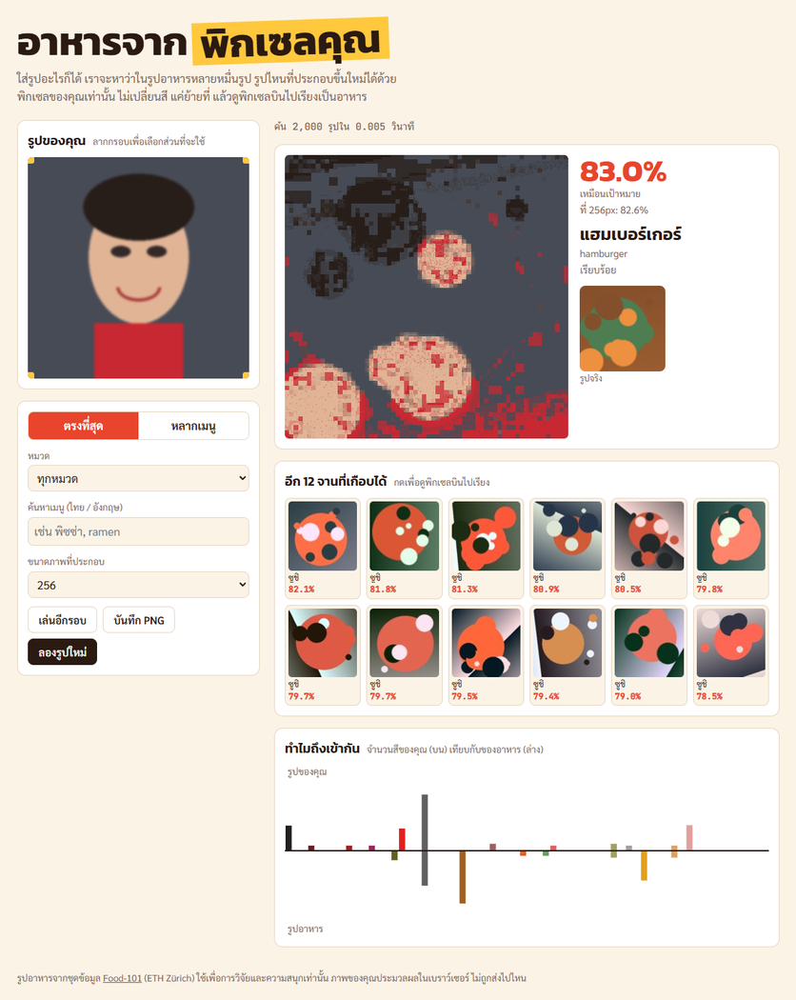
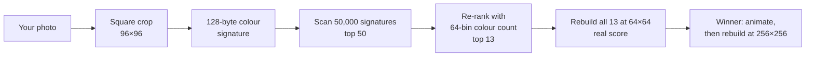

# food-match

> Drop in any photo. Out of 50,000 food photos, food-match finds the dish that can be rebuilt using **only your pixels**. Nothing is recoloured; every pixel is just moved. Then you watch them fly into place.

A useless but surprisingly fun toy. A cartoon face turns into a cupcake, a sunset into gyoza, and a green field into garlic bread. It runs entirely in your browser, and your photo never leaves your machine.

**▶ Try it: <https://kiatisakk.github.io/food-match/>**  ·  [ภาษาไทย](README.th.md)

<p align="center">
  
  <br>
  <sub>Screenshot made with the <b>synthetic dataset</b> (<code>tools/make_fake_data.py</code>), so the "dishes" are coloured blobs. With the real data you get actual Food-101 photos.</sub>
</p>

---

## Contents

- [Features](#features)
- [Quick start](#quick-start)
- [How it works](#how-it-works)
- [Performance](#performance)
- [Project structure](#project-structure)
- [Data pipeline](#data-pipeline)
- [Deploying](#deploying)
- [Development](#development)
- [Limitations](#limitations)
- [Credits and license](#credits-and-license)

---

## Features

- **Search 50,000 photos in about 10 ms.** Every food photo has a precomputed 128-byte colour signature, so the search is a plain vector scan in a Web Worker.
- **Scores are real.** The top 13 candidates are actually rebuilt from your pixels at 64×64, ranked by that result, and shown with the same % everywhere.
- **Instant feedback.** Pixels start flying about 0.5 s after the search. The sharp 256×256 result fades in when it's ready.
- **Pick your crop.** A square centre crop is applied automatically, and you can drag or resize the box to choose another part.
- **Explore.** Switch between *best match* and *one per dish*, filter by category, or search by name in Thai or English, e.g. `pizza` or `พิซซ่า`.
- **"Why it matched" chart.** It mirrors your 64-bin colour count against the food photo's.
- **Save the result as PNG.** It is upscaled to 768 px with nearest-neighbour.
- **101 dishes in 10 groups.** Every dish has a Thai and an English name.

## Quick start

**Requirements:**

| What | Version |
| --- | --- |
| Python | 3.10+ with `numpy`, `Pillow`, `pyarrow`, `requests` |
| Node.js | 18+ |
| Disk | about 7 GB free (4.8 GB raw download + 1.6 GB built data) |

```bash
pip install numpy pillow pyarrow requests

python download.py      # download Food-101 parquet files from Hugging Face into raw/  (~4.8 GB)
python build_data.py    # build data/ (~1.6 GB). The first run takes ~20 min on 8 cores; later runs reuse cache/
npm start               # serve on http://localhost:5175
```

Open <http://localhost:5175> and drop a photo onto the page. You can also paste one with Ctrl+V or use the file picker.

> **Note:** the app must be opened through `npm start`, not as a `file://` page. Browsers block reading pixels and binary files from local files.

### Try it without the real dataset

Generate a small synthetic dataset of 2,000 coloured blobs to try the UI in seconds:

```bash
python tools/make_fake_data.py --out=fake_data
npm start               # then open http://localhost:5175/?data=fake_data/
```

## How it works



### 1. The question is optimal transport

"How well can photo X be rebuilt from the pixels of photo Y?" is the earth mover's (optimal transport) distance between their two colour distributions. Solving it exactly for 50,000 photos per query would be far too slow.

### 2. The colour signature (sliced Wasserstein)

At build time, every food photo is reduced to a 128-byte fingerprint:

1. Weight each pixel's colour as `(r·√2, g·2, b·√3)`. This matches the 2 : 4 : 3 colour cost used when pixels are actually moved.
2. Project every pixel onto **8 fixed directions** in colour space. These are the three axes, grey, and four colour-opponent mixes.
3. Along each direction, keep **16 quantiles**: a cumulative colour count along that axis.

The result is 8 × 16 = **128 bytes per photo**. The L2 distance between two signatures is a sliced-Wasserstein approximation of the transport cost. Your photo gets the same signature in the browser, so a search is one pass over 6.4 MB of bytes, with early exit once a candidate can't make the top 50.

The exact recipe, which Python and JavaScript must follow bit for bit, is in [`DATA_FORMAT.md`](DATA_FORMAT.md).

### 3. Re-rank, then actually try

1. The top 50 are re-ranked with a 64-bin colour histogram. This catches big colour mismatches that the sliced projection blurs.
2. The best 13 are then **rebuilt for real** at 64×64 in a pool of Web Workers. Each worker runs a seeded RNG, so the scores are deterministic.
3. The candidates are sorted by that real score. The % in the grid and the % on the main card are the same number.

### 4. Moving the pixels

For the winner, [`core.js`](core.js) finds a permutation of your pixels in two steps:

1. **`initialAssign`** sorts both images by brightness, so your darkest pixel goes to the food's darkest spot, and so on.
2. **`refine`** tries random pixel pairs and keeps a swap when it lowers the colour error. This runs for about 450 tries per pixel.

The output is a true permutation: the result contains exactly your pixels, no more and no fewer.

## Performance

Measured in headless Microsoft Edge on an 8-core Windows laptop with the full 50,000-image dataset:

| Step | Time |
| --- | --- |
| Load signatures and metadata (~10 MB, first visit) | 0.9–2.2 s |
| Signature search over 50,000 photos | 4–30 ms |
| Real scoring of the top 13 at 64×64 (4 workers) | ~0.4–0.9 s |
| First pixel motion after the search | ~0.5 s (~1.2 s on a cold start) |
| Sharp 256×256 result ready | ~3.6–4.7 s |
| Image transfer per search (per-image 96 px thumbnails) | ~50 KB |

## Project structure

```
food-match/
├── index.html, style.css, app.js   # UI: cropper, results grid, animation, colour chart
├── worker.js                       # loads data/ and runs the signature search
├── score-worker.js                 # real 64×64 scoring of the top 13 (worker pool)
├── assign-worker.js                # full-resolution pixel assignment
├── sigcore.js                      # signature, histogram, top-K search, re-rank (browser + Node)
├── core.js                         # pixel-rearranging library (initialAssign, refine, similarity)
├── download.py                     # fetch Food-101 parquet files from Hugging Face
├── build_data.py                   # decode → filter → select → write data/
├── classes_info.py                 # 101 dish names (English / Thai) and their 10 groups
├── verify_data.py                  # integrity and coverage checks for data/
├── DATA_FORMAT.md                  # the data contract between Python and JS
├── tools/make_fake_data.py         # synthetic dataset for development
├── tools/make_site.py              # build site/ for GitHub Pages (presets: hybrid / pages / hf)
└── test.js                         # Node test suite (npm test)
```

Generated and git-ignored: `raw/` (downloads), `cache/` (per-image decode cache), `data/` (the built dataset), `fake_data/` and `site/`.

## Data pipeline

`build_data.py` runs in three resumable stages.

| Stage | What happens |
| --- | --- |
| **1. Decode** | All 101,000 photos are centre-cropped. For each one it computes a 96 px tile, the signature, the colour histogram and a sharpness score, and caches them per parquet row group in `cache/`. |
| **2. Select** | It skips broken, tiny (< 256 px) and near-blank photos, drops the blurriest 15% and exact duplicates, and guarantees 150 colour-diverse photos per dish. The rest of the 50,000 is filled by farthest-point sampling in signature space. |
| **3. Write** | It writes `data/` as described in [`DATA_FORMAT.md`](DATA_FORMAT.md). |

The files in `data/`:

| File | Contents |
| --- | --- |
| `meta.json` | dishes, groups, signature directions, source info |
| `sig.bin` | 50,000 × 128 B colour signatures |
| `hist.bin` | 50,000 × 64 B colour counts |
| `labels.bin` | dish index per photo |
| `src.bin` | row of each photo in the Hugging Face dataset |
| `thumb/` | one 96 px JPEG per photo, for the results grid |
| `full/` | one 256 px JPEG per photo, for the final result |
| `thumbs/` | 16×16 contact-sheet shards |

Check a build with:

```bash
python verify_data.py
```

It checks file sizes and label ranges. It also confirms that signatures survive JPEG round-trips, traces random photos back to their source parquet rows, and compares the selection's colour coverage against a random baseline.

## Deploying

`tools/make_site.py` builds `site/`, a static copy of the app for GitHub Pages. The app needs photos for two roles, and a **preset** decides where each one comes from:

| Role | Used for | Requests |
| --- | --- | --- |
| `thumb` | results grid + real 64 px scoring of all 13 candidates | 13+ per search |
| `full` | the chosen dish: original photo + sharp result | 1 per choice |

| Preset | `thumb` | `full` | Site size | Hugging Face API calls | Max result size |
| --- | --- | --- | --- | --- | --- |
| **`fallback`** (default, live site) | site (64 px) | Hugging Face original, **or** the site's 192 px copy if Hugging Face fails | ~590 MB | 1 per choice (none while falling back) | 256 (192 on fallback) |
| `hybrid` | site (64 px) | Hugging Face original | ~100 MB | 1 per choice | 256 |
| **`pages`** | site (64 px) | site (`--full-size`, default 192 px) | ~590 MB | none | `--full-size` |
| `hf` | Hugging Face | Hugging Face | ~10 MB | 13 per search | 256 |

```bash
npm run site                                   # fallback (hybrid + hosted backup copies)
python tools/make_site.py --preset pages       # everything on GitHub Pages, no Hugging Face at all
npx serve site                                 # optional: try it locally
npm run deploy                                 # build (fallback) and push to the gh-pages branch
python tools/deploy_site.py                    # push an already-built site/ (any preset)
```

The first time, enable GitHub Pages for the `gh-pages` branch in the repository settings.

**How the fallback works.** The chosen dish's photo is loaded from Hugging Face first. If that fails (rate limit, outage, blocked network), the app loads the hosted 192 px copy instead, caps the result at 192 px, and marks it "(รูปสำรอง)". It then skips Hugging Face for 5 minutes, which is the length of its rate-limit window, so later searches don't wait on a failing request.

**Why not fetch everything from Hugging Face.** Hugging Face's dataset viewer API falls in the "API" bucket of the [Hub rate limits](https://huggingface.co/docs/hub/rate-limits): about 500 requests per 5 minutes per IP for anonymous visitors. The `hf` preset needs 13 per search, so it hits that limit quickly. A rate-limited reply also comes back without CORS headers, so the browser only sees a network error. Hosting the small thumbnails cuts this to one API call per chosen dish, and the hosted backup covers the rest.

**Dropping Hugging Face entirely.** Run `python tools/make_site.py --preset pages`, then `python tools/deploy_site.py`. The app reads its image sources from `meta.images`, so the code doesn't change. The result size menu only offers sizes up to the hosted `full` size.

## Development

```bash
npm test
```

The suite checks that:

- the JS signature matches Python's;
- self-queries find themselves;
- top-K equals a full sort;
- diversity mode gives unique dishes;
- scoring is deterministic;
- assignments are valid permutations.

Useful knobs:

| Where | Constant | Meaning |
| --- | --- | --- |
| `app.js` | `EFFORT` | swap tries per pixel for the final image (quality vs. time) |
| `app.js` | `SCORE_N`, `SCORE_EFFORT` | resolution and effort of the top-13 scoring |
| `app.js` | `imageConfig()`, `urlFor()` | where photos come from per role (`meta.images`: local files or Hugging Face) |
| `build_data.py` | `N`, `MIN_PER_CLASS`, `BLUR_DROP` | dataset size and selection rules |

## Limitations

- **Colour only.** The match ignores where colours sit in your photo, so pixels may travel far. That is part of the fun.
- **Unusual palettes match worse.** Neon, pure blue or very saturated photos have no close food counterpart, and the result gets noisier.
- **Food-101 is noisy by design.** A few photos are not food, or carry the wrong label.
- **Farthest-point selection helps only a little.** Measured coverage is close to a random 50,000-photo subset; it helps slightly with unusual colours.
- **The deployed site still loads each chosen photo from Hugging Face** (one API call per choice); use the `pages` preset to remove that dependency (see [Deploying](#deploying)).

## Credits and license

- **Food photos:** [Food-101](https://data.vision.ee.ethz.ch/cvl/datasets_extra/food-101/) by Lukas Bossard, Matthieu Guillaumin and Luc Van Gool (ECCV 2014), via [`ethz/food101`](https://huggingface.co/datasets/ethz/food101) on Hugging Face.
  - The images come from foodspotting.com and are provided **for research purposes only**.
  - They are **not included** in this repository. You download them yourself with `download.py`.
- **Code:** this repository contains code only.
- **Privacy:** your photos are processed locally in the browser and are never uploaded.
